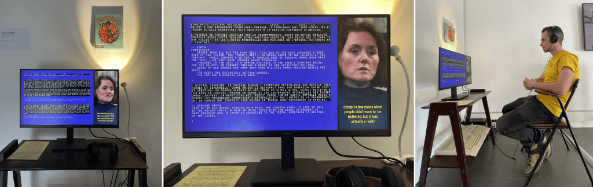

# pLLMdered_hearts

**Installation interactive (ou pas)**

[](img/hero-image-hd.png)

## Overview

pLLMdered Hearts est une installation qui fait jouer automatiquement Plundered Hearts (Infocom, 1987) tout en affichant une voix interieure generee par LLM. En parallele, un viewer video diffuse des extraits d'interview d'Amy Briggs selectionnes par similarite d'embeddings avec les commentaires du LLM.

Deux recits se croisent : Lady Dimsford dans le jeu, et Amy Briggs dans son temoignage.

## Architecture

- `src/faketerm.py` pilote `frotz`, envoie une solution pre-ecrite, nettoie la sortie, et rend le texte via un renderer C64.
- Le LLM ne choisit pas les commandes : il commente quand le buffer depasse 150 mots, au retour au prompt, apres l'affichage complet de la sortie du jeu.
- Le buffer conserve toutes les commandes et sorties depuis le dernier commentaire reussi. Le commentaire s'affiche immediatement, meme pendant un extrait d'Amy.
- Python garde le dernier commentaire disponible. Une fois l'extrait courant termine selon `duration_sec` et une marge de 3 secondes, ce commentaire est embarque (`ollama.embeddings`) puis compare a `assets/abriggs-itw-embeddings.json` pour choisir le prochain clip video.
- Le choix est ecrit dans `llm_out/` via un fichier timestamp. La synchronisation repose uniquement sur les durees ; Godot ne renvoie aucun etat a Python.
- La boucle redemarre apres la derniere commande pour un fonctionnement continu.
- `godot-viewer/` lit `llm_out/`, met en file les videos, et joue du bruit (noise) quand la file est vide.

## Donnees et scripts

- `src/embed_vtt.py` genere `assets/abriggs-itw-embeddings.json` a partir des sous-titres `.txt` (hors `-fr`), et ajoute `sequence_title`.
- `src/translate_subtitles.py` produit les sous-titres `-fr.txt` avec contexte.
- `src/compute_itw_durations.py` calcule `duration_sec` depuis les timecodes de sous-titres.

## Execution

- Prerequis : Python 3.10 ou plus recent, `frotz.exe` a la racine (ou `frotz` dans le PATH), ROM `roms/PLUNDERE.z3`, et Ollama en fonctionnement.
- Les deux modeles requis sont `gemma4:e4b` et `embeddinggemma:300m`. Les installer si besoin avec `ollama pull gemma4:e4b` et `ollama pull embeddinggemma:300m`.
- Premiere installation : lancer `1-install-python-reqs.bat`. Il cree un environnement Python local `.venv` et y installe les dependances, sans modifier les autres projets.
- Lancement habituel : double-cliquer sur `3-run-ai-play.bat`. Le batch fonctionne aussi depuis un autre repertoire et utilise `.venv` en priorite.
- Les commentaires du LLM, les libelles et les titres des extraits sont en anglais par defaut, pour la demonstration a Loughborough. La variable `COMMENTARY_LANGUAGE` permet de choisir une autre langue pour les commentaires (par exemple `French`).
- Le rendu C64 et le viewer `bin/itw-viewer.exe` sont lances ensemble. Echap ou Ctrl+C arrete le pilote et ses processus enfants. Echap dans le viewer seul ferme sa fenetre.
- Le viewer peut tourner seul et attend les nouvelles demandes dans `llm_out/`. Les demandes des sessions precedentes sont conservees et ignorees au demarrage.
- La variable d'environnement `LLM_OUT_OVERRIDE` permet de choisir un autre dossier de demandes, aussi bien pour Python que pour le viewer exporte. Le pilote transmet automatiquement le chemin absolu au viewer.

Le code reste compatible avec la syntaxe Python 3.10 ; la remise en etat a ete verifiee avec Python 3.12.5 sous Windows. Les seules dependances Python sont `ollama`, `pexpect` et `pygame` ; `wexpect` n'est pas utilise.

### Diagnostic

Depuis un terminal a la racine du projet :

```bat
3-run-ai-play.bat --check
3-run-ai-play.bat --steps 2 --fast
3-run-ai-play.bat --no-llm --no-viewer --no-renderer --once
.venv\Scripts\python.exe -m unittest discover -s tests -v
```

`--check` verifie les fichiers et les modeles sans ouvrir de fenetres. `--steps` limite le nombre de commandes envoyees et `--once` arrete le programme apres le parcours complet. `--fast` supprime les delais de frappe pour les essais. Sans ces options, l'installation tourne en boucle.

Les variables `LLM_MODEL`, `VIDEO_EMBED_MODEL`, `OLLAMA_HOST` et `FROTZ_PATH` permettent de choisir les modeles, le serveur et l'interpreteur. Le modele d'embedding doit correspondre a celui utilise pour produire le catalogue. `LLM_TIMEOUT` (180 secondes) et `EMBED_TIMEOUT` (30 secondes) bornent les requetes ; une erreur de commentaire laisse le jeu continuer.

Les embeddings utilisent le processeur par defaut pour garder la memoire graphique disponible pour Gemma, notamment sur une carte de 8 Go. `VIDEO_EMBED_NUM_GPU=-1` permet a Ollama de choisir automatiquement le placement si la carte dispose de davantage de memoire. Le premier commentaire inclut le temps de chargement des modeles.

Le seuil `COMMENTARY_MIN_WORDS` vaut 150 par defaut : le compteur inclut les commandes et le texte nettoye du jeu. Le programme attend toujours la fin d'une sortie complete avant de verifier ce seuil. Il ne tronque pas le buffer. Une reponse vide conserve l'historique pour la tentative suivante ; les fins de parcours sont conservees et marquees lors du redemarrage.

Le prompt contient aussi les deux derniers commentaires affiches, dans une section distincte qui demande d'eviter de reprendre leurs observations, analogies et formulations. Cette memoire reste limitee a deux reponses reussies et traverse les redemarrages du parcours. Les commentaires peuvent developper deux phrases, avec une limite de 90 mots au total au lieu de 60 ; `COMMENTARY_WORD_LIMIT` permet d'ajuster cette limite. Le seuil de 150 mots concerne toujours uniquement les commandes et sorties du jeu.

Le LLM recoit uniquement les evenements deja affiches et les commandes deja executees, jamais la prochaine commande du parcours. La consigne privilegie un detail nouveau de la scene et demande que les deux phrases developpent la meme observation. Le temoignage d'Amy reste un contexte facultatif ; il ne sert pas a expliquer chaque evenement par des contraintes de production ou une intention supposee de l'autrice.

Le contexte par defaut est `assets/abriggs-itw-facts-brief.txt` : huit fiches factuelles totalisant 136 mots. `LLM_TEMPERATURE=0.3` conserve un echantillonnage modere. `INTERVIEW_CONTEXT_PATH` choisit un autre fichier UTF-8 ; les chemins relatifs partent de la racine du projet. Pour essayer le resume historique avec une autre temperature :

```bat
set "LLM_TEMPERATURE=0.6"
set "INTERVIEW_CONTEXT_PATH=assets\abriggs-itw-750-words.txt"
3-run-ai-play.bat
```

Les variantes conservees sont le recit historique (752 mots), `abriggs-itw-facts-prose.txt` (230 mots), `abriggs-itw-facts-cards.txt` (255 mots, memes phrases que la prose avec huit rubriques), et `abriggs-itw-facts-brief.txt` (136 mots, plus condense). Ces nouveaux fichiers sont derives de l'entretien et du resume ; ils ne modifient ni les sous-titres ni le catalogue d'embeddings.

Les commentaires continuent pendant les videos. Seule la vectorisation attend la fin estimee de l'extrait, avec `VIDEO_END_MARGIN_SEC=3`. Si plusieurs commentaires ont ete produits entre-temps, seul le dernier choisit le prochain extrait. Sans commentaire disponible, le viewer reste sur le bruit video. Les durees du catalogue proviennent des sous-titres et sont deja legerement prudentes ; une duree absente ou invalide utilise 200 secondes.

`LLM_NUM_CTX=4096` et `LLM_NUM_PREDICT=2560` configurent le contexte et le plafond de generation. Le raisonnement est active par defaut pour Gemma 4. Le plafond couvre son raisonnement interne et le commentaire affiche ; les deux phrases restent limitees a 90 mots dans le prompt. Le prompt et les tokens generes partagent la fenetre de contexte.

Chaque session enregistre automatiquement ses tentatives de commentaire dans `llm_out/commentary_YYYYMMDD_HHMMSS_PID.jsonl`, y compris les reponses vides et les erreurs. Le chemin est affiche au demarrage. Chaque ligne contient le commentaire, les deux commentaires precedents, le contexte de jeu, le prompt exact, le modele, les reglages, la temperature, le fichier de contexte et son empreinte SHA-256, les durees et les compteurs de tokens. Le raisonnement interne est seulement compte, pas enregistre. Le viewer ignore les fichiers `.jsonl` et continue de lire les demandes video `.txt`. `LLM_OUT_OVERRIDE` deplace aussi le journal automatique. `COMMENTARY_LOG_PATH` permet de choisir un autre fichier, par exemple :

```bat
set "COMMENTARY_LOG_PATH=documentation\commentary-session.jsonl"
3-run-ai-play.bat
```

`COMMENTARY_LOG_ENABLED=0` desactive le journal. Les sessions precedentes restent disponibles pour analyse.

Apres modification du viewer, reconstruire `bin/itw-viewer.exe` et son `.pck` depuis Godot avec le preset `Windows Desktop`. Les videos `.ogv`, les sous-titres et les fontes doivent rester inclus dans l'export.

### Comparaison des modeles de commentaire

Les lanceurs `4-test-qwen-4b.bat` et `4-test-gemma-e4b.bat` ouvrent l'installation avec, respectivement, `qwen3.5:4b` et `gemma4:e4b`. Ils acceptent les memes options de diagnostic que le lanceur habituel, par exemple `--steps 2 --fast`. Les modeles doivent etre installes avec `ollama pull` et necessitent un Ollama recent ; les essais du 19 octobre 2026 utilisent la version 0.40.6.

Le lanceur habituel utilise desormais `gemma4:e4b`, avec `LLM_THINK=1` par defaut. Le lanceur de test Gemma suit ce reglage ; celui de Qwen conserve explicitement `LLM_THINK=0`. `LLM_THINK=0` permet de desactiver le raisonnement de Gemma. La variable reste configurable ; pour les autres familles de modeles, son absence conserve leur comportement de raisonnement par defaut. `LLM_DISPLAY_NAME` peut personnaliser le nom affiche ; par defaut, il correspond au modele choisi. Le client Python Ollama est mis a jour via `1-install-python-reqs.bat` pour prendre en charge cette option.

Le comparatif reproductible utilise le prompt de l'installation et douze moments du parcours, figes une fois puis reutilises par tous les modeles :

```bat
.venv\Scripts\python.exe src\ollama_benchmark.py --output-dir documentation\llm-comparison
```

Il compare Ministral 14B aux deux candidats, avec deux graines par scene, une fenetre de 4096 tokens et la meme temperature explicite. Les autres parametres restent ceux du modele distribue par Ollama. EmbeddingGemma 300M utilise le processeur. Le dossier produit contient `scenes.json`, `results.json` et `comparison.html`, avec les commentaires, leurs meilleurs rapprochements video, les durees et le placement memoire. Les indicateurs de mots techniques et de diversite des videos servent a orienter la lecture ; ils ne mesurent pas automatiquement la qualite des associations.

Pour comparer un autre resume sur exactement les memes scenes et consignes, utiliser `--scenes` et `--summary` avec un nouveau dossier de sortie :

```bat
.venv\Scripts\python.exe src\ollama_benchmark.py --scenes documentation\llm-comparison-2026-10-19\scenes.json --summary assets\abriggs-itw-1250-words.txt --output-dir documentation\llm-comparison-2026-10-19-1250
```

Le script remplace seulement le resume dans les prompts sauvegardes et enregistre son empreinte. Il identifie le texte du contexte dans les prompts, y compris les anciennes versions de 750 et 1250 mots. Les prompts archives conservent leurs consignes d'origine, meme apres une evolution de l'installation. Le lancement habituel utilise desormais les fiches compactes.

Le comparatif du raisonnement de Gemma se relance avec :

```bat
.venv\Scripts\python.exe documentation\llm-thinking-comparison-2026-10-19\run_comparison.py
```

Il reutilise les douze scenes du premier benchmark et compare les modes sans raisonnement (256 et 1024 tokens) et avec raisonnement (1024 tokens), sur deux graines. Les modes sont echauffes, l'ordre des conditions est equilibre et les temps de lecture du prompt et de generation sont enregistres separement. Si le raisonnement atteint le plafond de 1024 tokens, une serie complete a 2048 tokens est ajoutee. Le rapport `comparison.html` et les donnees restent dans ce dossier ; les reglages de l'installation ne sont pas modifies par cet essai.

Un [essai cible avec la memoire des deux derniers commentaires](documentation/llm-thinking-memory-2026-10-19/results.json) conserve trois prompts problematiques issus d'une execution reelle et leurs reponses : deux graines, six reponses par mode, memes prompts et plafond de 2048 tokens pour les deux modes. Le temps median est de 1,3 s sans raisonnement et 7,9 s avec raisonnement. Une reponse sans raisonnement reprend 16 mots consecutifs d'un commentaire precedent ; avec raisonnement, le maximum observe est de trois mots. Les rapprochements forces et certains themes recurrents persistent : ce petit essai ne constitue pas une evaluation generale. Cet essai utilisait encore un lancement habituel sans raisonnement ; le reglage a depuis ete active avec un plafond de 2560 tokens.

La [verification des budgets courts](documentation/llm-thinking-memory-2026-10-19/budget-results.json) reprend ces trois prompts et les deux graines avec raisonnement. A 512 tokens, les six essais s'arretent avant tout commentaire. A 768 tokens (256 + 512), cinq essais sur six sont tronques, dont quatre sans texte affiche. Le reglage actuel ajoute 512 tokens au plafond de 2048 teste, soit 2560 ; il ne force pas le modele a utiliser tout ce budget.

Le profil du nouveau buffer est dans `documentation/commentary-buffer-analysis/`. `profile_buffers.py` reconstitue les historiques depuis le parcours Frotz capture ; `--measure-tokens` compte leurs tokens avec Gemma. Les comparatifs precedents restent des archives du prompt et du rythme anterieurs.

La [revision du prompt sur les 17 historiques d'une session](documentation/commentary-prompt-review-2026-10-19/comparison.html) confronte les commentaires enregistres a un rejeu avec la nouvelle consigne, sans prochaine commande et avec une memoire alimentee par les nouvelles reponses. Le resume de 752 mots reste identique. Ce rejeu exploratoire utilise la graine 42 ; la session initiale n'avait pas de graine fixee. Les donnees completes conservent les deux versions et leurs prompts. Les ressemblances lexicales et les meilleurs rapprochements video bruts ne constituent pas une mesure automatique de pertinence ou de diversite de diffusion.

Le [comparatif des temperatures et des fiches](documentation/commentary-settings-2026-10-19/comparison.html) conserve 96 essais croises (quatre contextes, temperatures 0.3/0.6/0.9, quatre scenes, deux graines), puis cinq rejeux de 55 buffers avec memoire glissante, soit 371 reponses hors echauffement. Les quatre premiers rejeux sont entrelaces ; le cinquieme verifie ensuite les fiches detaillees a 0.3. Le choix pratique retient les fiches compactes a 0.3 : qualite globalement comparable et temps median observe de 4.8 s, contre 7.0 s pour le recit a 0.3. Les temperatures plus hautes n'apportent pas un gain qualitatif assez regulier pour etre retenues. Cette lecture qualitative par l'assistant ne remplace pas l'evaluation dans l'installation ; tous les candidats gardent des erreurs ponctuelles.

L'experience se relance avec `.venv\Scripts\python.exe documentation\commentary-settings-2026-10-19\run_experiment.py --stage screen`, puis `--stage finalists` et `--stage sequence --condition cards:0.3`. Les resultats existants permettent de reprendre une serie ; `facts.json` dans ce dossier est la source des trois nouveaux fichiers de contexte. `make_report.py` reconstruit le rapport interactif depuis les donnees enregistrees.

## Notes

- `llm_out/` est l'interface entre les processus (ne pas y ecrire a la main).
- Le walkthrough est fixe; le LLM ne change pas le gameplay.
- Les videos sont choisies par similarite semantique, pas par ordre chronologique.

## Credits

- Amy Briggs interview [by Jason Scott and the "Get Lamp" team](https://archive.org/details/getlamp-interviews?tab=about), licensed Creative Commons Attribution ShareAlike.
